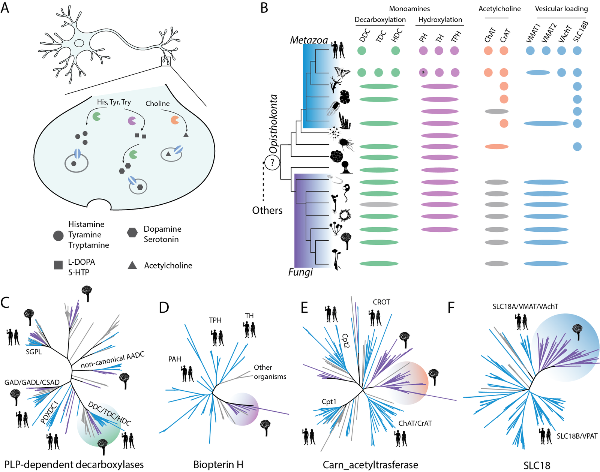

# MicroNerv

Code and data for

> Pyrris Y., Diallinas G., Pittis A.A.
> **Pre-neuronal origins of monoamine and acetylcholine synthesis and transport.**
> bioRxiv (2026). doi: [10.64898/2026.10.09.757917](https://doi.org/10.64898/2026.10.09.757917)

## Funding

**This work was funded by the Hellenic Foundation for Research and Innovation (H.F.R.I. / ΕΛ.ΙΔ.Ε.Κ.)**
under the “3rd Call for H.F.R.I. Research Projects to support Post-Doctoral Researchers”
(**Project Number: 7561, MicroNerv**, “Microbial roots of the animal nervous system: homologs of neuronal
molecular components in unicellular animal relatives and fungi”; PI: A. A. Pittis).

## About

Orthologs of the enzymes that make monoamines and acetylcholine (AADC, AAAH, ChAT/CrAT) and of the
vesicular transporters that load them into synaptic vesicles (SLC18) are widespread in fungi. We follow these
families across Opisthokonta and test their function in the model fungus *Aspergillus nidulans*.

A short walkthrough of every analysis (methods, inputs, outputs and the figures they produce) is in
[`docs/WALKTHROUGH.md`](docs/WALKTHROUGH.md).

> **Status:** the code and processed data are being added. The walkthrough lists what each folder will contain.

## What is here

| Analysis | Figures | Folder |
|---|---|---|
| Gene-family phylogenies (HMMER, DIAMOND clustering, MAFFT, trimAl, IQ-TREE) | 1, 3 | [`phylogenies/`](phylogenies/) |
| Targeted metabolomics of *A. nidulans* overexpression strains | 2 | [`metabolomics/`](metabolomics/) |
| Localisation of synaptic-vesicle protein homologs (BLASTP, DeepLoc 2.0, GO-slim) | 4 | [`sv_localization/`](sv_localization/) |
| RNA-seq of *A. nidulans* grown with trace amines (STAR, featureCounts, PyDESeq2, GOATOOLS, antiSMASH) | 5 | [`rnaseq/`](rnaseq/) |

Microscopy, strain construction and growth tests are experimental and are described in the Methods of the paper.

## License

MIT (see `LICENSE`). Third-party datasets keep their original licenses.
