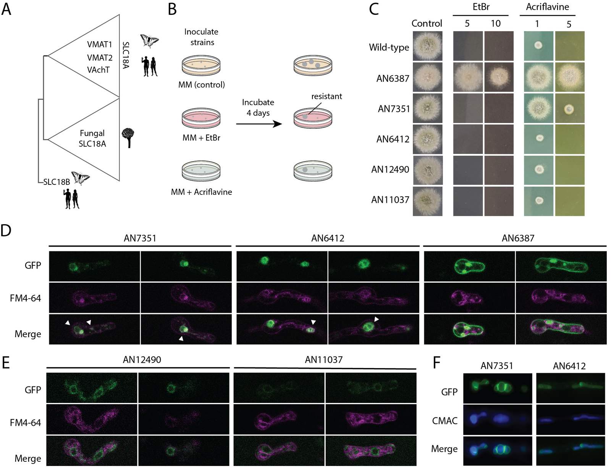
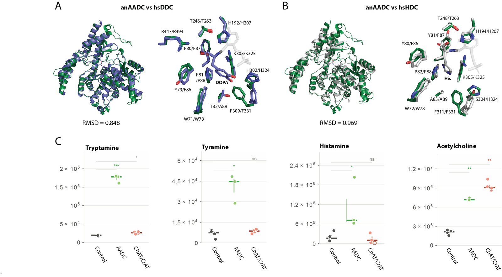
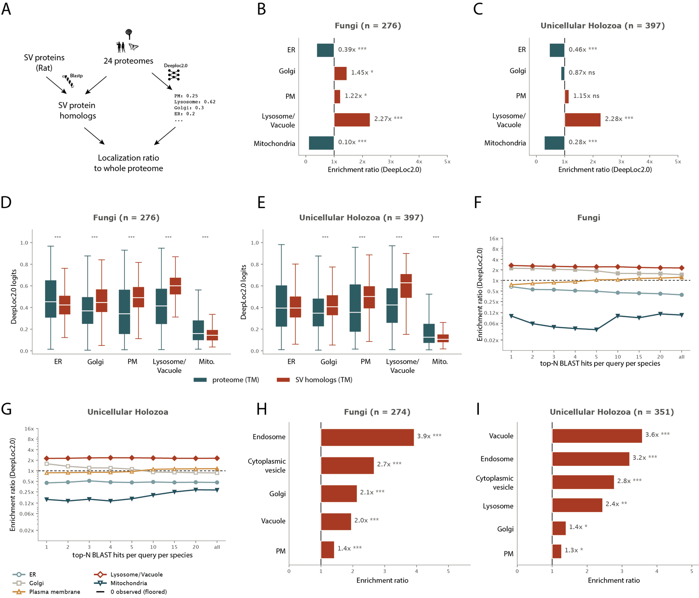
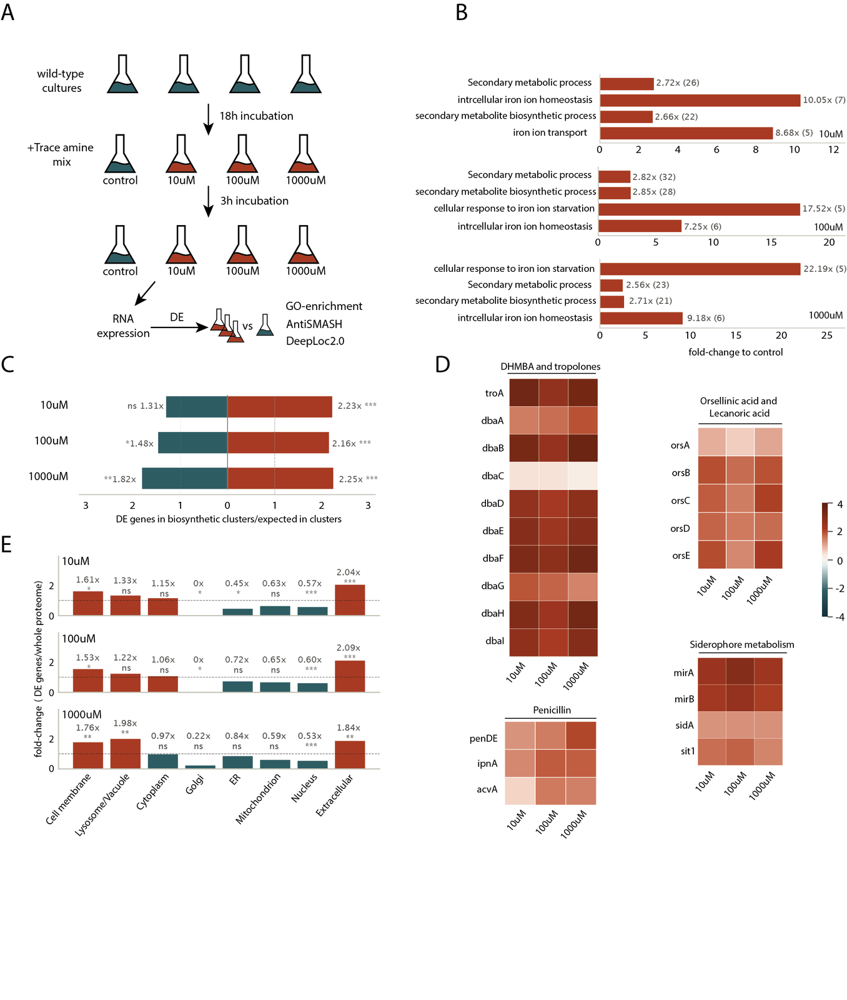

# Analysis walkthrough

**Pre-neuronal origins of monoamine and acetylcholine synthesis and transport**
Pyrris, Diallinas, Pittis

*Funded by the Hellenic Foundation for Research and Innovation (H.F.R.I.), “3rd Call for H.F.R.I. Research Projects to support Post-Doctoral Researchers”, Project Number 7561 (MicroNerv).*

The paper asks which parts of the neuronal machinery for monoamine and acetylcholine synthesis and vesicular transport
were already present in the common ancestor of animals and fungi. Four computational analyses support it: gene-family
phylogenies, metabolomics of fungal enzyme overexpression strains, the predicted localisation of synaptic-vesicle (SV)
protein homologs across Opisthokonta, and the transcriptional response of *Aspergillus nidulans* to trace amines.
Full methods are in the paper; this page summarises them and points to the code. Figures are reproduced from the preprint (CC-BY 4.0).

| Analysis | Figures | Folder |
|---|---|---|
| [1. Gene-family phylogenies](#1-gene-family-phylogenies) | 1, 3 | `phylogenies/` |
| [2. Metabolomics](#2-metabolomics) | 2 | `metabolomics/` |
| [3. Localisation of SV protein homologs](#3-localisation-of-sv-protein-homologs) | 4 | `sv_localization/` |
| [4. RNA-seq of *A. nidulans* with trace amines](#4-rna-seq-of-a-nidulans-with-trace-amines) | 5 | `rnaseq/` |

## 1. Gene-family phylogenies

*Fig. 1, Fig. 3A*

*Figure 1. Homologs of the monoamine and acetylcholine toolkits are widespread. (A) Monoamine and acetylcholine pathways in bilaterian neurons. (B) Presence and absence of the synthesis and transport genes across Opisthokonta. (C–F) Trees of the PLP-dependent decarboxylases, biopterin-dependent hydroxylases, carnitine acyltransferases and SLC18 transporters.*

- **Families:** Pyridoxal_deC (PF00282, AADC), Biopterin_H (PF00351, AAAH), Carn_acyltransf (PF00755, ChAT/CrAT) and MFS (PF07690, SLC18).
- **Search:** HMMER 3.3.2 `hmmsearch` with the Pfam gathering thresholds, against the reference proteomes of Table S1.
- **SLC18:** the 8,546 MFS proteins were clustered with DIAMOND v2.1.10 (`--approx-id 20 --member-cover 40`, 346 clusters). The two clusters containing known SLC18 proteins were kept.
- **Trees:** MAFFT v7.505 E-INS-I, trimAl v1.5 (`-gt 0.1`), IQ-TREE 3.0.1 with ModelFinder and 1,000 ultrafast bootstraps.
- **Output:** alignments, trees and domain annotations for iTOL. Interactive trees for all families are also provided as a small web interface.

The SLC18 tree (Fig. 3A) frames the functional tests of the fungal transporters (growth on ethidium bromide and acriflavine, GFP localisation), which are experimental.

*Figure 3. Fungal SLC18s confer chemical resistance and localise to the vacuole.*

## 2. Metabolomics

*Fig. 2*

*Figure 2. The fungal AADC can synthesise trace amines: structural comparison with the human DDC and HDC, and metabolomics of the overexpression strains.*

- *A. nidulans* FGSC A4 wild type and strains overexpressing the fungal AADC or PAH, grown 18 h at 25 °C in minimal medium, with ≥ 3 biological replicates. Metabolomics was done by the EMBL Metabolomics Core Facility.
- **Statistics:** Welch's t-test on log₁₀(peak area) against the control, Benjamini–Hochberg q < 0.05, and effect sizes as Hedges' g.

## 3. Localisation of SV protein homologs

*Fig. 4*

*Figure 4. Synaptic-vesicle protein homologs have a major lysosomal component.*

- **Query:** 119 resident SV proteins of *Rattus norvegicus*.
- **Search:** BLASTP against 24 opisthokont proteomes (E ≤ 10⁻⁴, up to 500 targets per query), excluding self-hits.
- **Prediction:** DeepLoc 2.0 localisation for every protein. Transmembrane proteins are those with a DeepLoc transmembrane score ≥ 0.8. The main analysis compares the homologs with each species' own transmembrane proteome.
- **Tests:** enrichment of predicted compartments with a species-weighted expectation, a query jackknife, and GO-slim cellular-component enrichment (UniProtKB annotations).

## 4. RNA-seq of *A. nidulans* with trace amines

*Fig. 5*

*Figure 5. Trace amine presence induces secondary-metabolism gene clusters in *A. nidulans*.*

- **Processing:** Trim Galore, then STAR 2.7.11b against ASM1142v1 (Ensembl Fungi 62), then featureCounts (paired, unstranded).
- **Differential expression:** PyDESeq2 0.5.4 with design `~ condition`, each concentration tested against the control. DE genes have adjusted P < 0.05 and |log2FC| ≥ 1.
- **Enrichment:**
  - GO enrichment with GOATOOLS 1.6.5 (Fisher's exact test, BH).
  - Biosynthetic gene clusters predicted with antiSMASH 8.0.4 (fungal mode).
  - Enrichment of DE genes in clusters tested by permutation (10,000 draws).

## Data

Raw sequencing reads and processed tables will be deposited in public repositories, and the accessions will be listed here.

## Reproduce

Each folder will hold its own environment file and a README with the commands to regenerate its figure panels.
